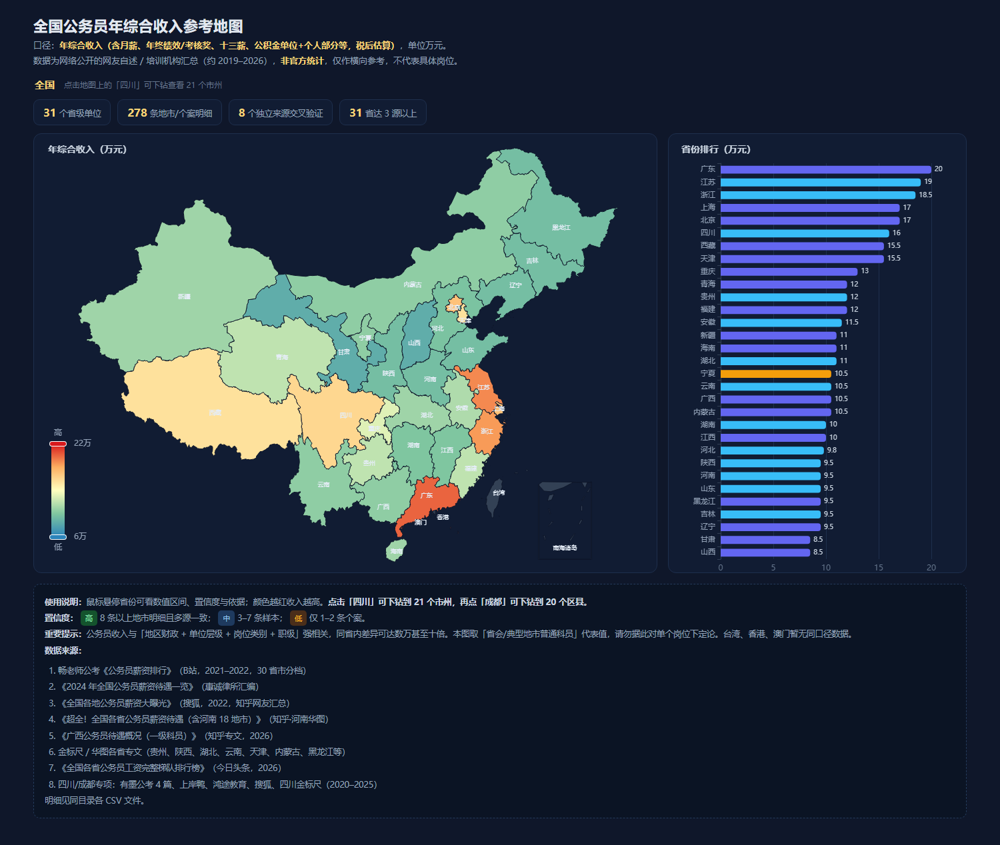
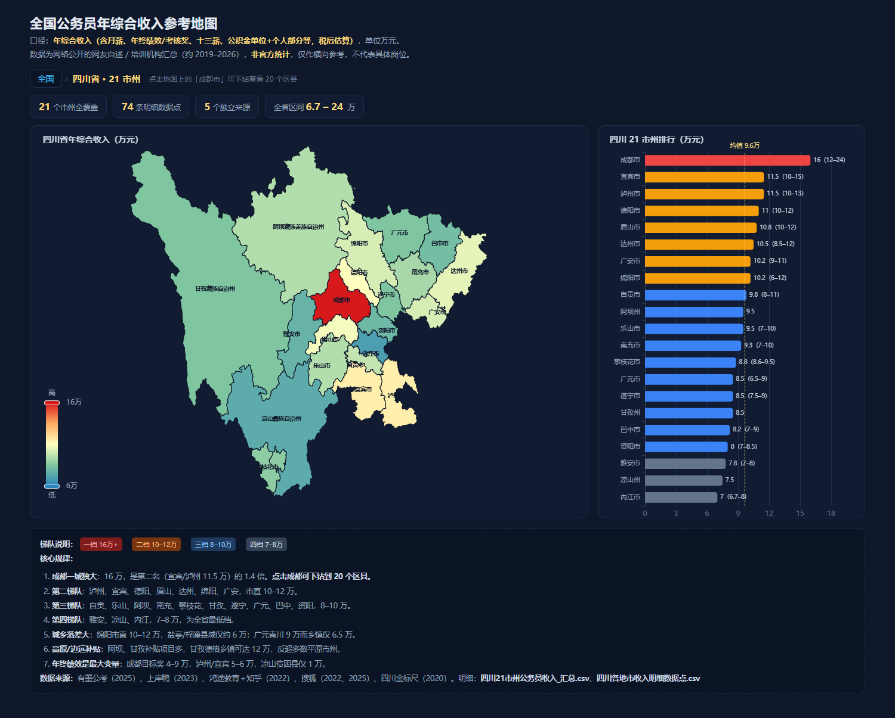
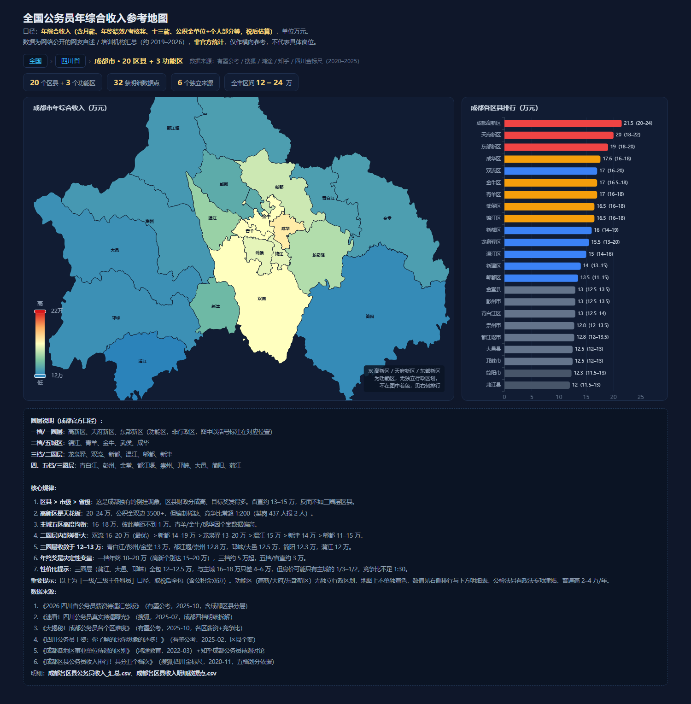

# gongkao-salary-map · 全国公务员收入地图

一个**单文件、离线可用**的交互式地图，支持三级下钻：

```
全国 31 省  →  四川省 21 市州  →  成都市 20 区县（+3 个功能区）
```

打开 `全国公务员收入地图.html` 即可使用，无需联网、无需服务器。ECharts 与三份 GeoJSON 已全部内嵌在 HTML 中。

## 预览

| 全国视图 | 四川省视图 | 成都市视图 |
| --- | --- | --- |
|  |  |  |

## 功能

- **三级下钻**：点击省份进入四川，点击成都市进入区县；面包屑 `全国 › 四川省 › 成都市` 可逐级返回。
- **联动排行**：右侧条形图随当前视图同步切换，按收入降序排列。
- **统计条**：显示当前层级的均值、最高、最低与样本量。
- **数据口径注释**：底部说明随视图切换，标明该层级的估算依据与不确定性。

## 数据口径

- **指标**：**年综合收入**，单位万元。
- **包含**：月到手工资 + 年终绩效/目标奖 + 十三薪 + 公积金双边。
- **税后估算**：以到手口径为主，公积金按双边计入。
- **性质**：基于网络公开分享数据的**交叉整理与估算**，非官方统计，仅供横向比较参考。
- **置信度**：高/中/低，取决于样本数与来源数，详见各 CSV。

成都的**成都高新区、天府新区、东部新区**不是独立行政区划，不在 GeoJSON 边界内，因此地图上不着色；它们只出现在右侧排行图、统计条与 CSV 中。

## 数据文件

| 文件 | 行数 | 说明 |
| --- | --- | --- |
| `data/各省公务员年综合收入_参考数据.csv` | 31 | 全国 31 省汇总，含区间、置信度、数据点数、来源数 |
| `data/数据明细_各地市收入数据点.csv` | 278 | 全国地市级明细数据点（月到手、公积金、年终、来源、年份） |
| `data/四川21市州公务员收入_汇总.csv` | 21 | 四川 21 个市州汇总，含梯队划分 |
| `data/四川各地市收入明细数据点.csv` | 69 | 四川市州/区县明细数据点 |
| `data/成都各区县公务员收入_汇总.csv` | 23 | 成都 20 区县 + 3 功能区汇总，含圈层划分 |
| `data/成都各区县收入明细数据点.csv` | 32 | 成都区县明细数据点 |

## 目录结构

```
.
├── 全国公务员收入地图.html      # 成品，双击即可打开
├── data/                        # 汇总与明细 CSV
├── assets/                      # 地图依赖（已内嵌进 HTML，此处保留作备份/重建用）
│   ├── china.json               # 全国省级边界（简称，如「四川」）
│   ├── sichuan.json             # 四川 21 市州边界（全称，如「阿坝藏族羌族自治州」）
│   ├── chengdu.json             # 成都 20 区县边界（如「锦江区」）
│   └── echarts.min.js
├── scripts/
│   ├── build_map.py             # 由 CSV + assets 重新生成 HTML
│   └── screenshot.py            # 三级视图截图与渲染报错检查
└── docs/                        # 预览截图
```

## 重新生成

```bash
python scripts/build_map.py
```

脚本以自身所在目录定位项目根，路径可移植；运行后会重写 `data/` 下的全部 CSV 与根目录的 HTML。

验证渲染（需要 `playwright` 与 Chromium）：

```bash
python scripts/screenshot.py
```

输出 `docs/` 下三张截图，并打印三级视图的面包屑、统计条与 console 报错情况。

## 数据来源

汇总自公开网络内容（含 B 站、知乎、搜狐、今日头条及各公考培训机构的省市专文），主要来源类型：

- 公考讲师经验分享（2021–2022）
- 律所/机构整理的各地公务员待遇汇编（2024）
- 知乎、搜狐等平台的地区汇总贴（2022–2026）
- 地方公考机构的省考/市考专项分析（2020–2025）

各数据点的具体来源与年份记录在明细 CSV 的 `来源`、`数据年份` 列中。

## 免责声明

本项目数据由网络公开信息交叉整理估算而来，**不代表任何官方口径**，可能存在偏差、滞后或样本偏差。请勿用于薪资谈判、报考决策等对准确性要求高的场景，亦不构成任何形式的承诺或建议。

地图边界数据来自 [DataV.GeoAtlas](https://datav.aliyun.com/portal/school/atlas/area_selector)，版权归原提供方所有。
